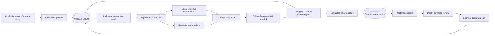

# GravityGuard architecture

GravityGuard is a modular monolith. The onboard FastAPI service and SQLite database run on the local computer. React uses real HTTP APIs through Vite's local proxy. The essential workflow has no cloud or LLM dependency after dependency installation.

## Boundaries

`backend/app/api` handles authentication and request authorization, validation, and transactions. `models/records.py` holds SQLAlchemy models. `services/ingestion.py` accepts sensor-independent measurements with immutable event IDs. `services/analysis.py` performs statistics; `risk_modules/trends.py` registers experimental rules. `services/safety.py` owns local escalation and a workflow action allowlist. `ai_assistant.py` explains structured evidence and optionally asks an LLM to prioritize existing evidence IDs. `earth_sync.py` owns simulated transfer. UI pages never manufacture clinical observations.

All measurements have collection and receive timestamps, source, origin, and quality. Origins are `simulated`, `manual`, `imported`, and `device`. `origin=simulated` is the default demonstration analysis. Baselines and analysis are matched by origin: manual/device data are not compared against synthetic references. Ingestion bounds are engineering validation bounds, not medical alarm limits.

Daily means keep a burst of live readings from satisfying a rule that requires multiple days. The last seven-day window requires at least three distinct collection days and a latest valid observation within 48 hours. A rule requires the last three available daily means to be on consecutive calendar days and all beyond its experimental personal-baseline delta. Prior-week mean and least-squares slope are descriptive; no forecast is calculated. Missing days and discarded samples remain visible. An older open alert is retained until reviewed even if a later analysis no longer flags, preserving its history; automatic clinical resolution is not implemented.

The three trend rules are +15% resting heart rate, -8% strength-test result, and +20% balance-test sway relative to an individual baseline over three consecutive days. These values were chosen for the synthetic demonstration. They are not NASA requirements or validated clinical thresholds. The symptom escalation rule uses an explicit self-report of warning signs or severity >= 8/10. It is not a clinically validated triage instrument and does not infer safety from free text.

## AI and medical guidance

The offline explanation is a deterministic template over structured statistics, references, limitations, and allowed actions. `ENABLE_LLM=true` plus backend-only `MODEL_API_KEY` enables a structured Responses API request to `https://api.meta.ai/v1/responses` using `muse-wonder-1.0`. The key is resolved at backend request time, never at import time or in React. Redirects are rejected, response bodies are size-limited, and network operations use a finite timeout. Credentials and raw provider errors are never logged or returned. The legacy metric-explanation provider receives aggregate evidence without user identifiers or free-text symptoms and can return only existing evidence IDs to emphasize. The new conversational path additionally receives the medical question and pseudonymous patient context; free-text questions/symptoms can contain identifying information entered by the user. Its expanded planning contract is described below. The server validates every returned ID, retains all evidence, and renders its own text. Unknown IDs, refusal, malformed output, timeout, and provider failure cause fallback. The provider cannot create a diagnosis, treatment, dosage, threshold, severity, or action. Live provider calls have not been verified in this environment.

The reference registry is versioned in `medical_knowledge/sources.json`. NASA references supply physiological and architectural background, not clinical approval. The installed protocol is explicitly `demo_only_not_clinically_approved`. The app therefore presents recording/review workflow steps, not a fabricated approved treatment protocol. Actual clinical procedures require qualified review outside this MVP.

## Store-and-forward model

On mutation, an immutable snapshot is encrypted with Fernet and queued with a destination, due time, retry count, and event ID. The queue and receipt survive restart. A due event is processed only while the link is online. Each event is applied within a savepoint, and invalid ciphertext retries with backoff. Newer snapshot capture times prevent late delivery from rolling the ground replica backward. Reprocessing delivered events has no effect. Feedback is accessible to the astronaut only after delivery; the doctor sees acknowledgment only after its downlink reaches the ground record.

The ground replica is a separate table in the same SQLite file. It is a logical isolation boundary, not an independently deployed Earth database. Both destinations are simulated locally; no external spacecraft transport occurs. Queue payload encryption does not encrypt the full health database. The generated demo key lives in ignored `.local/sync.key` with 0600 permissions; production key distribution, rotation, storage encryption, and authenticated HTTPS transport remain future work.

The frontend polls every eight seconds and processes due messages while a user is signed in. `/api/sync` can also be called manually. There is no autonomous delivery worker or WebSocket implementation. `delay_seconds` is a demonstration wall-clock delay per leg, not an asserted real mission latency. Changing delay affects newly queued events. Mission profile changes do not alter experimental medical thresholds.

## Extension points

New sensors implement the existing ingestion schema; unsupported metrics must first be registered with a unit and engineering bounds. Add matching non-synthetic personal baselines before running non-synthetic comparisons. Add new rule adapters under `risk_modules` with source provenance and tests. `PredictionProvider` in `services/interfaces.py` reserves a future validated model contract; no implementation or forecast endpoint exists. Replace the local transport adapter and ground replica with an authenticated Earth receiver while preserving event IDs and receipt semantics. Schema migration tooling is needed before evolving a deployed database.

## Sources

- [NASA: The Human Body in Space](https://www.nasa.gov/humans-in-space/the-human-body-in-space/)
- [NASA: Clinical Decision Support System Concept of Operations](https://ntrs.nasa.gov/api/citations/20220017856/downloads/HRP-48033_ExMC_CDSS_ConOps.pdf)
- [Meta: Structured output](https://dev.meta.ai/docs/structured-output)
- [Meta: Responses API](https://dev.meta.ai/docs/protocols/responses)

## Operator connection diagnostics

The standalone `scripts/test_meta_connection.py --live` command is explicit operator opt-in and calls the backend provider adapter directly. It does not use the application's `ENABLE_LLM` gate. The application still requires that gate and `use_llm=true`. CLI diagnostics use a closed set of local codes and numeric HTTP status; raw errors and response bodies are never printed. CLI and application share the same strict response/ID validation, but the CLI has a longer timeout to distinguish connectivity from application latency policy.

Empty focus arrays mean no evidence prioritization; repeated allowed IDs are deduplicated. Both are permitted by the submitted JSON Schema. Neither removes evidence or enables model-authored medical actions. Incomplete responses, even with HTTP 200, remain failures with deterministic offline fallback in the application.

## Grounded conversational assistant

The [five-layer implementation](medical-assistant.md) adds reviewed source snapshots, SQLite FTS5 retrieval, bounded Muse Wonder planning, origin-matched patient context, persisted assistant messages, and shared short/detailed answer rendering in both workspaces. New tables are additive: `knowledge_documents`, `knowledge_chunks`, `knowledge_fts`, and `assistant_messages`. Healthcare measurement records are not rewritten.

Ingestion validates source review metadata, permissions, HTTPS source/policy domains, and normalized-text checksums before changing the index. Updates are idempotent, and missing FTS rows are repaired on re-ingestion. Retrieval uses local lexical BM25 ranking with a small source-diverse packet; rank is not clinical confidence. Sources are categorized as terrestrial fundamentals or NASA space medicine. The index is built from checked-in excerpts at startup, not scraped from the internet at runtime. Startup indexing failures do not prevent core monitoring.

`assistant_safety.py` evaluates reported warning signs before remote planning; an unresolved urgent onboard alert also takes precedence. Urgent output bypasses Muse Wonder even if remote AI is enabled. Source-index failure retains urgent local guidance. For nonurgent questions, the provider can select only known passage, explanation, and follow-up IDs; local rendering verifies the allowlists and source support. It cannot author new user-visible treatments or actions. Every answer preserves provenance, unavailable measurements, uncertainty, and references. Question UUIDs make retries idempotent, and each conversation creates an alert with its structured answer in the existing encrypted downlink snapshot. Doctors see that answer only once delivered.

## Current conversational architecture

The catalog-based conversational milestone described above is superseded by the [model-generated redesign](conversational-redesign.md). The primary `/api/assistant/messages` path now runs dynamic context planning, selective record/retrieval access, free structured generation, provenance validation, and an automated semantic audit. It does not use `candidates()` or the reference-selector coverage gate. Additive thread/turn tables provide bounded user-owned parent-chain context. The existing trend selector and reference-only planning endpoint remain separate compatibility features. Read the linked report for the exact remaining deterministic safety rules and the model-dependent educational/current-symptom distinction.
